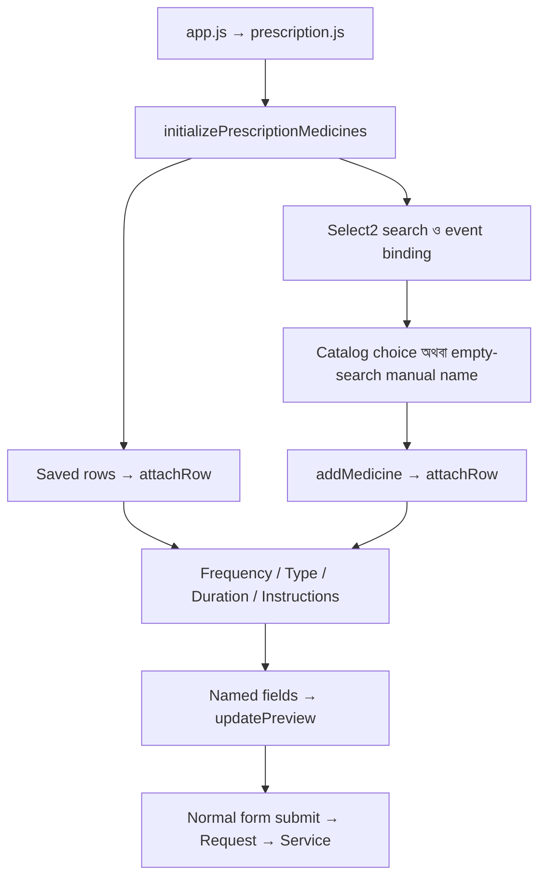

# Prescription Medicine JS lifecycle

এই নথি General Prescription-এর Rx medicine editor-এর জন্য। Entry কোথা থেকে শুরু হয়,
কোন field আসল data রাখে, এবং পরিবর্তনের সময় কোন function দেখতে হবে—সেগুলো এখানে আছে।
Glass Prescription-এর আলাদা form এই editor ব্যবহার করে না।

## 1. Entry ও file ownership

[Core layout](../Core/resources/views/layouts/app.blade.php) থেকে Vite asset আসে।
[`app.js`](../../resources/js/app.js) → [`prescription.js`](../../resources/js/prescription.js)
→ `initializePrescriptionForm()` → `initializePrescriptionMedicines()` এই entry chain।
`#prescription-form` না থাকলে General editor initialize হয় না।

| File | কাজ |
| --- | --- |
| [prescription-medicines.js](../../resources/js/prescription-medicines.js) | Search, medicine row, schedule, duration, unit ও Rx preview |
| [prescription-application-dose.js](../../resources/js/prescription-application-dose.js) | Dosage group, Drop/Gel quantity ও daily-use entry |
| [prescription-instructions.js](../../resources/js/prescription-instructions.js) | Food buttons, instruction search ও inline instruction save |
| [prescription-keyboard.js](../../resources/js/prescription-keyboard.js) | Shortcut ও field-to-field focus |
| [prescription-palette.js](../../resources/js/prescription-palette.js) | Dose/Unit-এর একই positioning, trigger keyboard, Escape ও open/close |
| [prescription-header-dropdown.js](../../resources/js/prescription-header-dropdown.js) | Modal header search-এর নিচে Select2 results রাখা |
| [select2-empty-search.js](../../resources/js/select2-empty-search.js) | Search-এ মিল না পাওয়ার পরই নতুন নাম যোগের অনুমতি |

## 2. Blade ও DOM contract

মূল form হলো [`form.blade.php`](resources/views/prescriptions/form.blade.php)-এর
`#prescription-form`। [`rx-modal.blade.php`](resources/views/prescriptions/rx-modal.blade.php)
form-এর বাইরে render হয়; তাই submit হওয়া modal control-এ `form="prescription-form"` থাকে।

| Selector | ব্যবহার |
| --- | --- |
| `#prescription-rx-modal` | Rx modal; validation/focus এখানেই ফিরে আসে |
| `#prescription-medicine-search` | Medicine বাছাইয়ের unnamed Select2 search |
| `#prescription-rx-options` | Search result-এর medicine chips |
| `#prescription-medicines` | Medicine row-এর বর্তমান DOM order |
| `#prescription-medicine-template` | নতুন row-এর Blade template; `__INDEX__` replace হয় |
| `.prescription-medicine-row` | একটি medicine-এর সব control ও row state |
| `#prescription-medicine-preview` | মূল pad-এর Rx summary |
| `#prescription-dose-palette`, `#prescription-unit-palette` | Reusable floating choices |

Row markup এক জায়গায়: [`medicine-row.blade.php`](resources/views/prescriptions/medicine-row.blade.php)।
একই partial saved row এবং `<template>`-এর জন্য ব্যবহৃত হয়।

### আসল submitted values

প্রতিটি row-এর নাম `medicines[index][field]`; নিচের সাতটি field server-এ যায়।

| Field | অর্থ |
| --- | --- |
| `product_id` | Catalog medicine ID; manual name হলে blank |
| `medicine_name` | Medicine name; catalog link থাকলে server catalog name ব্যবহার করে |
| `dosage_type` | `tablet_capsule`, `drop`, `gel_ointment` অথবা `other` |
| `frequency` | `1+0+1` অথবা application directions-এর মতো মূল Dose text |
| `dose` | UI-এর Unit label; যেমন `টা`, `ফোটা`, `চামচ` |
| `duration` | `5 দিন`, `চলবে` অথবা Custom text |
| `instructions` | Food instruction অথবা নির্বাচিত custom instruction |

UI-এর **Dose** label আসলে `frequency` field সম্পাদনা করে; **Unit** label `dose` field লেখে।
Drop quantity/times, duration count/unit, schedule buttons এবং instruction search নিজে আলাদা
medicine column পাঠায় না; এগুলো উপরের canonical field-গুলো update করে।

## 3. Browser state কোথায় থাকে

`initializePrescriptionMedicines()`-এর state তার closure-এ থাকে; কোনো global Rx store নেই।

| State | কেন দরকার |
| --- | --- |
| `nextIndex` | নতুন input name-এর index; saved index-এর সর্বোচ্চ মানের পর থেকে বাড়ে |
| `rowsByChoice` | Choice ID → matching jQuery rows; আগে থেকে থাকা একাধিক matching row-ও ধরে |
| `optionsByChoice` | Choice ID → Select2 `<option>`; একই option বারবার বানায় না |
| `suggestionButtons` | Choice ID → result chip; selection highlight update করে |
| `unitNames` | Preset, loaded ও saved Unit label-এর Set |
| `unitButtons` | Label → current palette button; duplicate button ঠেকায় |
| `$activeDose`, `$activeUnit` | খোলা palette কোন control-এর জন্য কাজ করছে |
| `$focusAfterOpen` | Modal খুলে গেলে কোন input-এ focus ফিরবে |
| `unitOptionsRequest`, `unitOptionsLoaded` | একসঙ্গে এক Unit request এবং loaded state |

প্রতি row-এ jQuery `.data()`-তে `choiceId`, `scheduleValues` ও `preview` থাকে।
এগুলো database field নয়; যথাক্রমে selection link, dose slots ও summary element ধরে।
Row delete হলে অন্য row-এর index নতুন করে সাজানো হয় না। Save order DOM-এর order থেকে আসে।

Instruction module-এর আলাদা `pendingInstructionWrites` counter এবং selector-এর
`instructionCreateRequest` আছে। Inline save চললে সেই row removal, Rx modal close এবং
Prescription submit অপেক্ষা করে; ব্যর্থ হলেও completion handler control আবার চালু করে।

## 4. Page initialize হওয়ার ধাপ

1. `PrescriptionController::formData()` saved/old medicine values ও প্রয়োজনীয় catalog metadata প্রস্তুত করে।
2. Blade saved row render করে; validation failure হলে old input অগ্রাধিকার পায়।
3. `initializePrescriptionMedicines()` DOM handles, palette, instruction manager ও maps তৈরি করে।
4. Saved row-এর input name পড়ে `nextIndex` নির্ধারণ করে এবং প্রতিটিতে `attachRow()` চালায়।
5. `attachRow()` frequency, duration, Unit, instructions, dosage mode, choice link ও preview প্রস্তুত করে।
6. Medicine Select2 configure হয়; তারপর selection/modal/row events bind হয়।
7. শেষে `initializePrescriptionKeyboard()` shortcuts ও focus order connect করে।

Initialize করার সময় saved custom directions নতুন format-এ লিখে দেওয়া হয় না।
চেনা duration/schedule controls-এ দেখা যায়; না চেনা text Custom/বর্তমান নির্দেশ হিসেবে থাকে।

### কোন function কোথা থেকে call হয়

| শুরু | Call flow |
| --- | --- |
| Page ready | `initializePrescriptionForm` → `initializePrescriptionMedicines` |
| Saved row / নতুন row | Saved-row iteration / `addMedicine` → `attachRow` → editors + `registerChoice` + `attachPreview` |
| Search selection | `select2:select` → `addMedicine` → `firstPrescriptionDoseControl` → `focusMedicineInput` |
| Schedule mode / dose choice | `changeScheduleMode` / `enterScheduleDose` / `selectDose` → `updateFrequency` → frequency `input` → `syncFrequencyPicker` → `updatePreview` |
| Type change | `changeDosageType` → `initializeFrequency` → `refreshUnitToggle` → `updatePrescriptionDoseType` → `updatePreview` |
| Duration change | `updateDuration` → duration-value `input` → `updatePreview` |
| Pad title / native invalid input | Title click / `showInvalidMedicine` → `focusMedicineInput` |

ফাইলের প্রথম নয়টি row/value helper module scope-এ আছে; প্রয়োজনীয় `$row`/value argument নেয়।
Maps/palettes-এর state-নির্ভর functions `initializePrescriptionMedicines()` closure-এর ভিতরে থাকে।

## 5. Search থেকে medicine যোগ হওয়া

Medicine search URL Blade-এর `data-url` থেকে আসে: `pharmacy.products.options`, `type=medicine`।
এটি existing Pharmacy catalog পড়ে; Rx editor থেকে নতুন Pharmacy Product তৈরি হয় না।
Search debounce `250 ms`; request-এ `search` ও `page` যায়।

`createEmptySearchGuard()`-এর `begin()` প্রতিটি search/page-এর identity রাখে।
`complete()` শুধু বর্তমান request-এর result গ্রহণ করে; আগের search-এর late response বাদ যায়।
`canCreate()` সত্য হয় যখন **বর্তমান প্রথম page সফলভাবে zero result দিয়েছে এবং আর page নেই**।
ফলে নিচে matching item থাকলে বা request এখনো শেষ না হলে typed name নতুন item হয় না।

`createTag()` eligible name-কে `manual:<name>` choice ID দেয়। Catalog choice-এ actual product ID থাকে।
`select2:select` → search close → `addMedicine()` → প্রথম dose control-এ focus।
`processResults()` dropdown-এর পাশাপাশি `renderSuggestions()` দিয়ে result chips refresh করে।

## 6. Add, edit ও remove lifecycle

- `addMedicine()` আগে `rowsByChoice` দেখে; একই selected choice থাকলে নতুন row না বানিয়ে সেটিই দেয়।
- নতুন row template থেকে আসে, `nextIndex` বসে, product/name fill হয় এবং list-এর শুরুতে prepend হয়।
- `attachRow()` controls, state, preview এবং native invalid-field focus connect করে।
- Pad-এর medicine title click করলে `focusMedicineInput()` সেই row-এর dose entry খুলে দেয়।
- Name সরাসরি বদলালে `detachRenamedMedicine()` → `detachChoice()` চলে; `product_id` ও Generic display clear হয়ে manual হয়।
- `removeRow()` pending instruction save পরীক্ষা করে, palettes ও Select2 বন্ধ/destroy করে,
  choice link, preview এবং row সরায়; তারপর count update করে।
- Search unselect বা selected chip click-এ `removeChoice()` matching rows সরানোর চেষ্টা করে।
  Pending save-এর কারণে row থাকলে search choice আবার selected রাখা হয়।

নতুন row উপরে আসে; saved rows-এর input index এবং visible order একই বিষয় নয়।
একটি row-এর input names বদলালে template, validation error IDs ও index parsing একসঙ্গে দেখতে হবে।

## 7. Type, frequency, duration, food ও Unit

### Tablet / Capsule ও Other

`readSchedule()` numeric/fraction `+`-separated frequency চিনতে পারে; অন্য text Custom থাকে।
`initializeFrequency()` saved value পড়ে; `renderSchedule()` প্রয়োজনীয় buttons বানায়।
Menu থেকে 3/4/5/6 slots বাছা যায়; matching saved 1–6 slots-ও restore হয়।
Dose button বা palette choice → `updateFrequency()` → canonical `frequency` → preview।
Typed frequency → `syncFrequencyPicker()` → matching schedule buttons।

### Drop ও Gel / Ointment

`initializePrescriptionDosage()` saved Type, catalog dosage অথবা explicit medicine-name token থেকে group নেয়।
Doctor Type বদলাতে পারেন; অচেনা brand name থেকে dosage অনুমান না করে `other` থাকে।
`updatePrescriptionDoseType()` application inputs দেখায়, oral Unit/food/schedule লুকায় ও food disable করে।
শুধু Type পাল্টানোর সময় আগের saved directions মুছে দেওয়া হয় না।

Quick field edit হলে `updateApplicationDose()` existing `frequency` লেখে এবং `dose` blank করে:

| Mode | Entry example | `frequency` example |
| --- | --- | --- |
| Drop | Amount `4`, দিনে `4` | `4 ফোঁটা করে 4 বার` |
| Gel | Amount `অল্প`, দিনে `4` | `অল্প করে 4 বার লাগাবেন` |

এগুলো entry-format example; JS medicine-এর clinical amount/times নিজে নির্ধারণ করে না।
`readApplicationDose()` শুধু editor-এর নিজের পরিচিত format থেকে quick inputs restore করে।

### Duration ও instructions

`initializeDuration()` পরিচিত English/Bengali unit restore করে; unmatched text Custom রাখে।
`updateDuration()` count + selected Bengali label লেখে; Continue → `চলবে`; Custom text সরাসরি থাকে।
`displayDurationMode()` প্রয়োজনমতো count hide/disable করে এবং Custom input দেখায়।

Food button → `selectInstruction()` → hidden `instructions` → `updateInstructionRow()` ও preview।
Selected food button থাকলে সেটি highlight হয়; অন্য instruction হলে removable badge দেখা যায়।
Instruction search-এও একই empty-search guard চলে। Create URL শুধু অনুমোদিত form-এ থাকে।
Explicit Create choice → AJAX `prescription.options.store`; success হলে সব row-এর local choices update হয়।
Field error input-এর কাছে থাকে; workflow/network message Toastr-এ যায়।

Unit button `dose` field-এর palette খোলে। `renderUnitPalette()` preset/saved labels দেখায়;
`loadUnitOptions()` catalog থেকে paginated extra labels আনে, failure হলে পুনরায় খোলায় retry করা যায়।
Unit select → hidden `dose` update → palette close → Duration focus।

### Palette-এর একই operation এক জায়গায়

`createPrescriptionPalette()` থেকে `open`, `close`, `bindToggle`, `update` পাওয়া যায়।
Medicine editor `bindToggle($rows, selector, openPalette)` দিয়ে Dose ও Unit-এর trigger bind করে।
Click, ArrowUp/Down, Enter/Space, প্রথম selected choice focus এবং Escape-এর নিয়ম একবারই লেখা আছে।
`closeOnEscape()` menu বন্ধ করে opener-এ focus দেয়; `closeOutside()` বাইরের click/focus-এ menu বন্ধ করে।
`openDosePalette()` ও `openUnitPalette()` নিজেদের selection/value rule রাখে; shared palette কোনো Type পরীক্ষা করে না।

## 8. Event ও preview flow

Specific handlers আগে চলে: medicine name detach, Unit label refresh, frequency sync, Type mode switch।
শেষের delegated `[name]` input/change handler সব medicine field-এর জন্য `updatePreview()` চালায়।
নতুন row-ও একই `$rows` delegation পায়; প্রতি add-এ পুরো form-এর events rebind করা হয় না।

`attachPreview()` একবার summary element তৈরি করে এবং row-এর `.data('preview')`-তে রাখে।
`updatePreview()` current fields থেকে name, Generic এবং directions update করে; database query করে না।
Dynamic names/directions jQuery `.text()` দিয়ে বসে, HTML হিসেবে interpret হয় না।
Clinical note previews-এর আলাদা [prescription-preview.js](../../resources/js/prescription-preview.js)
আছে; Rx medicine summary-এর owner `prescription-medicines.js`।

Modal open-এর focus rule `focusOpenedModal()`-এ এবং close/pending-save rule `closeEditor()`-এ আছে।
`closeMedicineControls($selects)` শুধু caller দেওয়া Select2 controls ও দুই palette বন্ধ করে।
Search খোলার সময় শুধু row selectors দেওয়া হয়; modal বন্ধের সময় header-সহ modal-এর সব selectors দেওয়া হয়।

## 9. Keyboard flow

| Key / action | ফল |
| --- | --- |
| `F2` / `Alt+M` | Rx খুলে medicine search focus |
| `F4` | Active row-এর Unit palette; application mode হলে প্রথম quantity field |
| `F8` | Rx Done/close; pending instruction save থাকলে close অপেক্ষা করে |
| Medicine name / Type-এ `Enter` | প্রথম applicable dose input |
| Dose text-এ `Enter` / forward `Tab` | Visible food choice, তারপর Unit |
| Schedule button-এ `0`–`6` | Value বসিয়ে পরের slot; শেষ slot-এর পরে food/Unit |
| Dose/Unit palette-এ arrows, `Home`, `End` | Visible enabled choice navigation |
| Food button select | Instruction বসিয়ে Unit focus |
| Drop/Gel quantity-এ `Enter` | Times → Duration count → Duration unit → instruction search |

Food buttons-এ Left/Right/Home/End কাজ করে; forward Tab Unit-এ যায়।
Dose text-এ ArrowDown visible schedule-এর প্রথম slot focus করে।
Palette-এ Escape প্রথমে palette বন্ধ করে focus ফেরায়; closed palette-এর trigger-এ Escape Rx close করতে পারে।
Shortcut handler অন্য modal open থাকলে কাজ করে না; modified Enter/IME typing বাধা দেয় না।

## 10. Submit থেকে server save

Medicine rows normal `#prescription-form` submit-এর অংশ; Rx medicine save-এর জন্য আলাদা AJAX endpoint নেই।
Inline instruction catalog creation-এর AJAX request এই form submission থেকে আলাদা।
Native input constraints এবং pending-save guard immediate feedback দেয়; final authority server।
[app.js](../../resources/js/app.js)-এর shared submit guard duplicate in-flight form submit ঠেকায়।

[PrescriptionRequest](app/Http/Requests/PrescriptionRequest.php) medicine array/fields, Type ও catalog ID validate করে।
[PrescriptionController::store()](app/Http/Controllers/PrescriptionController.php) →
[BaseController::saveData()](../Core/app/Http/Controllers/BaseController.php) →
[PrescriptionService::save()](app/Services/PrescriptionService.php) transaction চালায়।
Service fresh authorization, branch Patient/Doctor ও Medicine catalog link পরীক্ষা করে,
header save করে এবং submitted order-এ medicine rows replace করে। `ordering` server নির্ধারণ করে।
সফল write-এর পরে view permission থাকলে show/print page-এ redirect হয়; অন্যথায় normal list redirect থাকে।

## 11. Function reference ও change guide

| কাজ | আগে যে functions দেখবেন |
| --- | --- |
| Row lifecycle | `addMedicine`, `attachRow`, `removeRow`, `removeChoice`, `updateCount` |
| Selection state | `registerChoice`, `detachChoice`, `selectChoice`, `deselectChoice`, `syncSearchChecks` |
| Search display | `medicineResult`, `renderSuggestions`, `updateSuggestion`, Select2 `createTag`/`data`/`processResults` |
| Frequency | `readSchedule`, `initializeFrequency`, `setFrequencyMode`, `renderSchedule`, `syncFrequencyPicker`, `updateFrequency`, `changeScheduleMode`, `enterScheduleDose`, `selectDose` |
| Duration | `initializeDuration`, `displayDurationMode`, `updateDuration`, `previewDuration` |
| Application | `dosageGroup`, `applicationType`, `readApplicationDose`, `updateApplicationDose`, `updatePrescriptionDoseType` |
| Focus | `focusMedicineInput`, `showInvalidMedicine`, `firstPrescriptionDoseControl`, `nextDoseControl` |
| Unit/palette | `refreshUnitToggle`, `appendUnitChoice`, `renderUnitPalette`, `loadUnitOptions`, `openUnitPalette`, `closeUnitPalette`, `selectUnit` |
| Dose palette | `openDosePalette`, `closeDosePalette`, `createPrescriptionPalette`, `bindToggle`, `closeOnEscape`, `closeOutside` |
| Instruction | `initializeRow`, `initializeInstructionSearch`, `selectInstruction`, `createInstruction`, `updateInstructionRow` |
| Instruction failure/pending | `showInstructionFailure`, `clearInstructionError`, `finishInstructionSave`, `preventWhileSaving`, `canRemoveRow` |
| Search eligibility | `setTerm`, `begin`, `complete`, `canCreate`, `bindSearch` |
| Preview/keyboard | `attachPreview`, `updatePreview`, `initializePrescriptionKeyboard`, `moveOnEnter`, `moveChoiceFocus`, `moveFromFrequency`, `moveFromFood`, `handleShortcut` |
| Modal/name/type events | `focusOpenedModal`, `closeEditor`, `closeMedicineControls`, `detachRenamedMedicine`, `changeDosageType` |

- Layout/field change: `medicine-row.blade.php` ও `rx-modal.blade.php`; selector ও `form` binding বজায় রাখুন।
- Dose format change: application/frequency functions-এর সঙ্গে saved-text restore ও preview দেখুন।
- নতুন persisted field: Blade → `PrescriptionRequest` → `PrescriptionService::medicineRows()` →
  [PrescriptionMedicine](app/Models/PrescriptionMedicine.php) এবং প্রয়োজনীয় migration একসঙ্গে পরিবর্তন করুন।
- নতুন shortcut: `prescription-keyboard.js`; normal Enter/Tab, Type override ও modal return focus মিলিয়ে দেখুন।
- Search change: `select2-empty-search.js`-এর current-request/zero-match নিয়ম বজায় রাখুন।
- UI hide/show: `[hidden]` control-এর ওপর Bootstrap display utility বসালে hiding override হচ্ছে কি না দেখুন।
- Verification: source JS syntax, `npm run build`, existing saved Rx restore, manual search, Type/duration,
  keyboard ও failed instruction save recovery দেখুন; এর জন্য নতুন business record save প্রয়োজন নেই।
